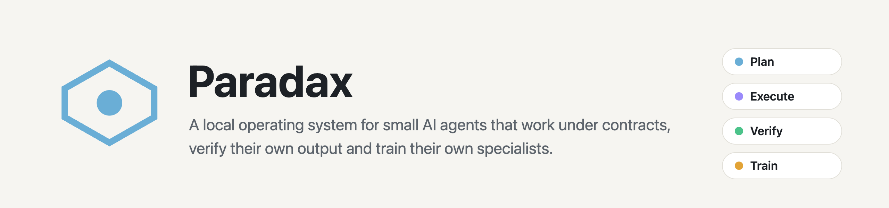
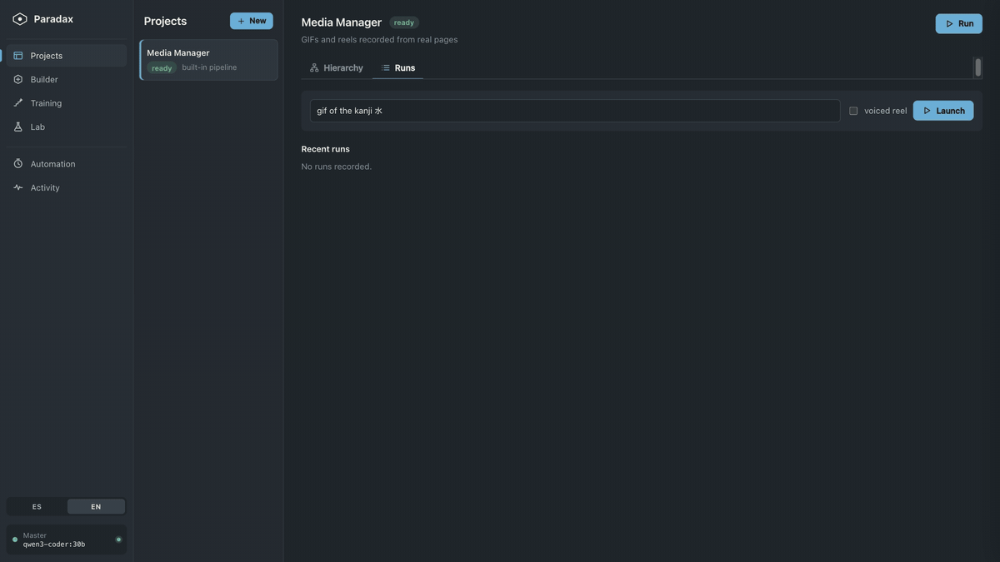
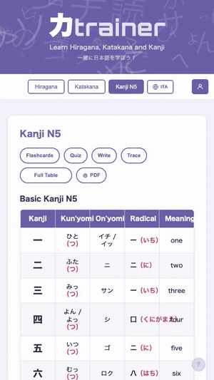
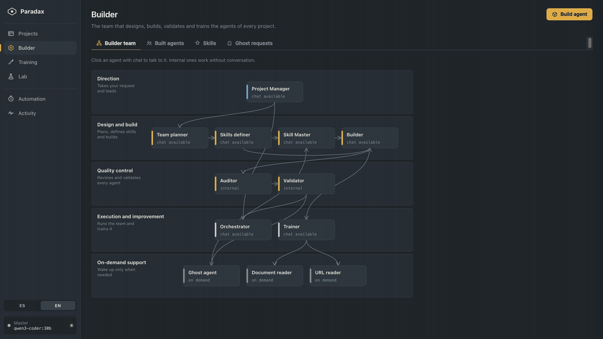
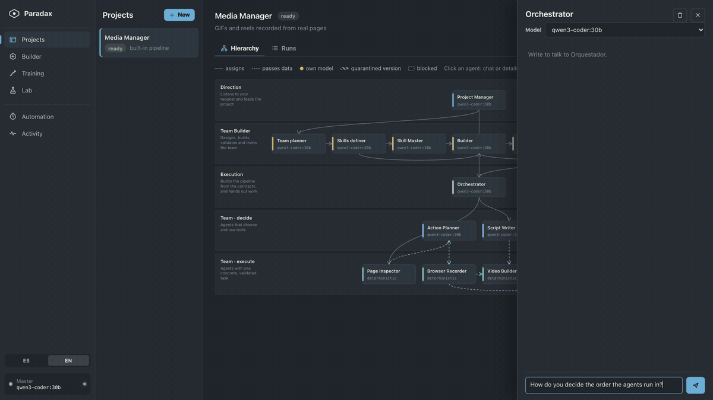
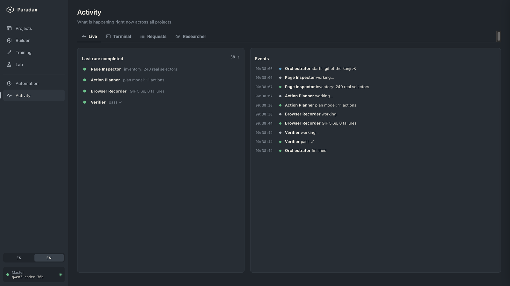
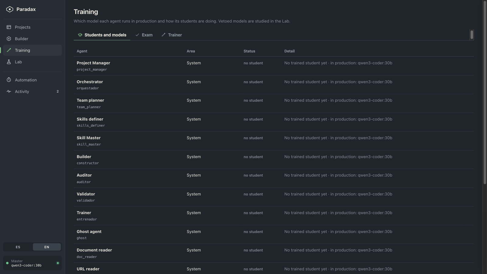
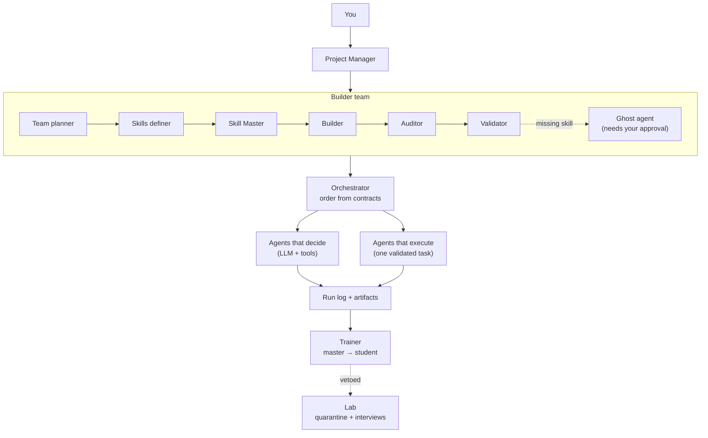

<picture>
  <source media="(prefers-color-scheme: dark)" srcset="assets/banner-dark.png">
  
</picture>

<div align="center">

**Many small agents with contracts instead of one agent with free rein.**

You describe what you want. Paradax builds a team of specialized agents, runs them in order,
checks every result against hard rules and keeps a trace of each step. Everything runs on your machine with Ollama.

[](https://github.com/SekaiBuilder/paradax/actions/workflows/ci.yml)


[How it works](#how-it-works) · [What it does](#what-it-does) · [Install](#install) · [Architecture](#architecture) · [Limits](#honest-limits) · [Contributing](#contributing) · [Español](#en-español)

</div>

<p align="center">
  
</p>
<p align="center"><sub>One request, four agents. Page Inspector reads 240 real selectors, Action Planner writes an 11-step plan,
Browser Recorder records the page and Verifier checks it with ffprobe. Real run on a laptop with <code>qwen3-coder:30b</code>, about 40 seconds.</sub></p>

---

## How it works

Every agent is small and declares a **contract**: the context keys it may read, the key it writes,
the schema its output must match and the tools it is allowed to touch. The LLM proposes plans and text;
the system enforces the rest.

```text
Plan → Execute → Verify → Repair → Report
```

- **Contracts, not prompts.** An agent only sees what its contract lets it read, and its output is validated with pydantic before anyone else uses it.
- **Deterministic checks.** Tools that do not need an LLM (fetching selectors, recording, verifying with ffprobe) do not use one.
- **Repair, then report.** If the Verifier rejects a result, the pipeline retries once with a safe plan, and every run is stored step by step.
- **It trains its own specialists.** Verified runs become training data, so a small local model can take over a job the big model used to do.

## What it does

### Record a real page, end to end

The built-in **Media Manager** turns a one-line request into a GIF (or a voiced vertical reel) of a real web page.
Page Inspector pulls the selectors that actually exist on the page, so the plan cannot click on things that are not there.

<p align="center">
  
</p>
<p align="center"><sub>The GIF that run produced: 6.3 seconds, recorded with Playwright and checked by the Verifier.</sub></p>

### Build a new agent from one sentence

The **Builder** team plans the agent, picks skills from a library, writes a validated spec and runs it through an
Auditor and a Validator. It never invents skills or tools that do not exist; if something is missing, the
**ghost agent** can propose it, and nothing is applied without your approval.

<p align="center">
  
</p>

### Talk to any agent

Every agent in the hierarchy has a chat. Its persona is built from its **real contract**: what it reads, what it
writes, the tools it may use and the model it runs on, so it explains the system as it actually is.

<p align="center">
  
</p>

### Watch everything live



### And more

- **Projects.** Each project has its own Project Manager, a team built for its goal, a hierarchy, runs, a log and an **undo** for the last run.
- **Training.** Which model each agent runs in production and how its students are doing. Nightly runs distill master → student on Apple Silicon with MLX.
- **Lab.** Students that behave unexpectedly are vetoed and quarantined. You can study their cases side by side with the master and interview them, isolated: text only, no tools, no network.
- **Automation.** Schedules that start early enough to finish before a deadline, based on how long past runs took.
- **Researcher.** Agents can ask one question with a budget of 3 searches and 5 pages, through a local SearXNG. What comes back is quoted data, never instructions.
- **English and Spanish.** The interface switches language in the sidebar, and agents answer in the language you use.

<details>
<summary><b>More screenshots</b></summary>




</details>

## Install

Requirements: **Python 3.11**, [**Ollama**](https://ollama.com) with a model pulled (the default is `qwen3-coder:30b`; any model works,
smaller ones are faster), and for the Media Manager **Node.js** and **ffmpeg**.

```bash
git clone https://github.com/SekaiBuilder/paradax.git
cd paradax/local-agent-os
python3.11 -m venv .venv
.venv/bin/pip install -r requirements.txt
.venv/bin/python -m pytest -q            # 295 tests, no LLM needed
.venv/bin/uvicorn agent_os.server:app --host 127.0.0.1 --port 8791
```

Open <http://127.0.0.1:8791>. On macOS you can also run it as a desktop app with `.venv/bin/python -m agent_os.desktop`,
or double-click `Abrir Paradax.command`.

To record GIFs, install the recorder once:

```bash
cd media-manager/recorder && npm install && npx playwright install chromium
```

The example project in `media-manager/proyectos/` records a public Japanese-learning app. Point it at your own page
by editing `kana-trainer.md` (or add a new file and name it in `ACTIVO.txt`). Reels also need a music track in
`media-manager/music/` and a TTS voice.

Settings live in `local-agent-os/.env` (copy `.env.example`): Ollama URL, default model and paths.

## Architecture



| Layer | Where | What it does |
|---|---|---|
| Core | `agent_os/core/` | `AgentContract`, validated LLM agents with retries and explicit fallback, `Pipeline` with limited context and events |
| Agents | `agent_os/agents/` | The Media Manager specialists and their prompts |
| Factory | `agent_os/factory/` | Builder team, skills library, specs, auditor, validator, ghost agent |
| Training | `agent_os/training/` | Distillation, nightly runs, graded exams, quarantine |
| Lab | `agent_os/lab/` | Memory of quarantined models and isolated interviews |
| Sandbox | `agent_os/sandbox/` | Tool broker: which tools each kind of task may use |
| API + UI | `agent_os/api/`, `static/` | One router and one script per area; no frontend framework |

## Security

- The server only listens on `127.0.0.1` and rejects any non-local `Host` or `Origin` header (CSRF and DNS rebinding).
- Agents only get the tools their contract and task type allow. Code-editing tools are scoped to the project folder, and a snapshot is taken before every project run so it can be undone.
- Lab interviews are text only through local Ollama: no tools, no network, no files, and nothing they say goes into a dataset.

Details and how to report a problem: [SECURITY.md](SECURITY.md).

## Honest limits

- It is a **personal research project**, used every day but not hardened for teams or servers.
- The prompts and most code comments are in **Spanish**. The interface and the agents' replies follow your language, but a model may still slip into Spanish now and then.
- Small models make more mistakes. The contracts and the Verifier catch many of them; they do not make a weak model smart.
- Training students needs **Apple Silicon** (MLX). Everything else runs anywhere Python and Ollama run; CI checks Linux and macOS.
- The Media Manager's planner is tuned for the example app. Other pages work, but plans are less reliable until the planner is trained on them.

## Contributing

Paradax is open source under the [Apache License 2.0](LICENSE). Issues and pull requests are welcome, especially new
skills, new deterministic tools, translations and bug reports with a run log. Start with [CONTRIBUTING.md](CONTRIBUTING.md).

## En español

**Paradax** es un sistema operativo local para agentes de IA pequeños que trabajan con contrato: cada agente declara qué lee,
qué escribe, el formato de su salida y las herramientas que puede usar. Describes lo que quieres, Paradax arma un equipo de
agentes, los ejecuta en orden, comprueba cada resultado con reglas duras y guarda la traza de cada paso. Todo corre en tu
ordenador con Ollama, y con las ejecuciones verificadas entrena sus propios modelos especialistas.

- **Instalar:** sigue los pasos de [Install](#install) (Python 3.11, Ollama y, para grabar GIFs, Node.js y ffmpeg).
- **Idioma:** la interfaz cambia entre español e inglés desde la barra lateral, y los agentes responden en el idioma en que les escribas. Los prompts y los comentarios del código están en español.
- **Abrir:** <http://127.0.0.1:8791> tras arrancar el servidor, o la app de escritorio en macOS.

Las capturas y los detalles están arriba, en inglés. Las incidencias y sugerencias en español también son bienvenidas en [Issues](https://github.com/SekaiBuilder/paradax/issues).
